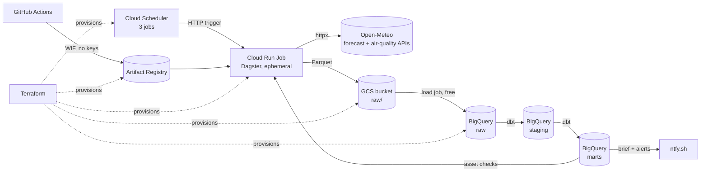

# Architecture

Hourly weather and air-quality data for **Sydney** and **Ulaanbaatar**, pulled from
[Open-Meteo](https://open-meteo.com/), landed in Cloud Storage as Parquet, loaded into
BigQuery, modelled with dbt, orchestrated by Dagster, and pushed to phones via ntfy.sh.

Everything runs on the **GCP Always Free tier** in **us-central1**.

## Data flow



One run of the pipeline does the following:

1. **Extract**: call the Open-Meteo forecast and air-quality APIs for each city.
2. **Land**: write one Parquet file per city and source to GCS.
3. **Load**: run a BigQuery **load job** from GCS into a date-partitioned `raw` table.
4. **Transform**: dbt builds `staging` (typing, dedup, local time) and `marts` (daily summaries, latest conditions).
5. **Check**: Dagster asset checks validate row counts, freshness, and value ranges.
6. **Notify**: send threshold alerts, plus a morning brief on brief runs.

## Components and free-tier budget

| Component | Free tier (us-central1) | How we stay under it |
|---|---|---|
| Cloud Storage | 5 GB-month regional storage | Files are a few KB each. A lifecycle rule deletes raw files after N days. |
| BigQuery | 10 GB storage, 1 TB query per month | **Load jobs only** (free; streaming inserts are billed). `maximum_bytes_billed` on every query. Tables **partitioned by date** so queries scan only the days they need. |
| Cloud Run Jobs | 180k vCPU-s, 360k GiB-s per month | A ~1 min hourly run at 1 vCPU ≈ 45k vCPU-s per month. |
| Cloud Scheduler | 3 jobs per account | Exactly 3: **hourly pipeline**, **Sydney morning brief**, **Ulaanbaatar morning brief**. Alerts run inside the hourly job. |
| Artifact Registry | **0.5 GB** storage | ⚠️ Biggest risk: a Dagster + dbt image is large. We use a slim multi-stage build and a cleanup policy that keeps only the latest 1–2 images. |
| Open-Meteo | Free for non-commercial use, ~10k calls/day | 4 calls per run → ~100 calls/day. |

## Key design decisions

- **Dagster runs ephemerally.** In the cloud there is no Dagster daemon or webserver,
  since those would need an always-on VM. The Cloud Run Job runs `dagster asset materialize`
  and exits. Cloud Scheduler handles scheduling. The Dagster UI is only used locally via
  Docker Compose.
- **UTC everywhere in storage.** We request `timezone=UTC` from Open-Meteo. Local time
  (Australia/Sydney, Asia/Ulaanbaatar) is derived in dbt staging models.
- **Load jobs, not streaming.** Load jobs are free and atomic. Re-running a day replaces
  that day's partition, so runs are idempotent.
- **No Secret Manager.** The only sensitive value is the ntfy topic name. It is passed to
  the Cloud Run Job as an environment variable, set from a Terraform variable whose value
  comes from a GitHub Actions secret.
- **No service-account JSON keys.** GitHub Actions authenticates to GCP with
  **Workload Identity Federation**: GitHub issues a short-lived OIDC token, and GCP trusts
  it for our repo only.

## Storage layout

The same Hive-style layout is used locally (`data/raw/`) and in GCS (`gs://<bucket>/raw/`):

```
raw/{source}/ingest_date=YYYY-MM-DD/{city}_{HHMMSS}Z.parquet
```

- `source`: `weather` or `air_quality`
- `city`: `sydney` or `ulaanbaatar`

## BigQuery datasets

| Dataset | Contents | Built by |
|---|---|---|
| `raw` | Parquet loaded as-is, partitioned by `DATE(time)` | Load jobs |
| `staging` | Cleaned, typed, deduplicated, with local time added | dbt |
| `marts` | Business-ready tables: daily city summary, latest conditions, alert candidates | dbt |

## Columns (raw)

Every row is one city, one source, and one hour.

- Common: `time` (UTC timestamp), `city`, `latitude`, `longitude`, `source`, `ingested_at`
- Weather: `temperature_2m`, `relative_humidity_2m`, `apparent_temperature`,
  `precipitation`, `weather_code`, `wind_speed_10m`
- Air quality: `pm10`, `pm2_5`, `nitrogen_dioxide`, `ozone`, `us_aqi`
